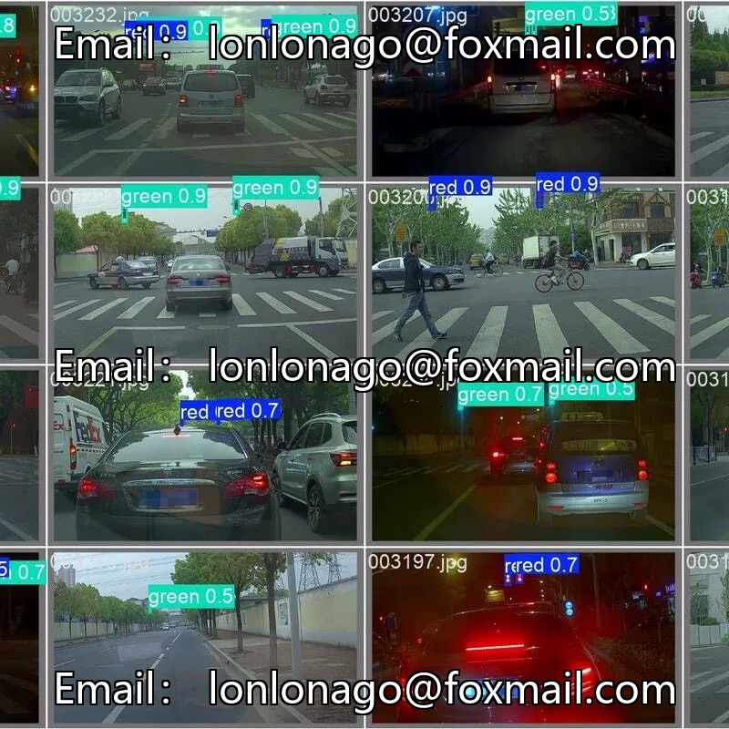
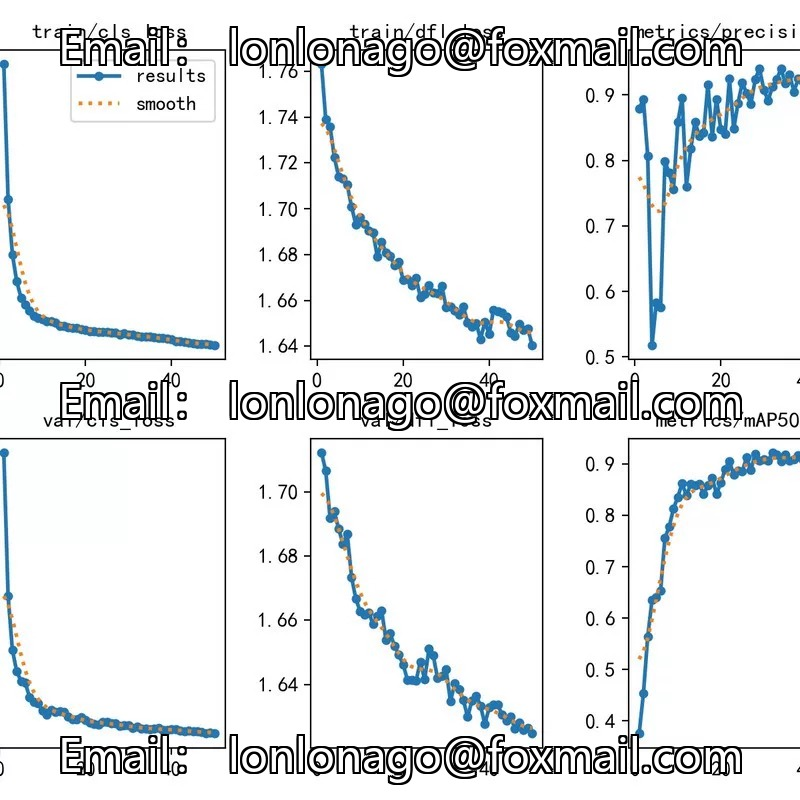
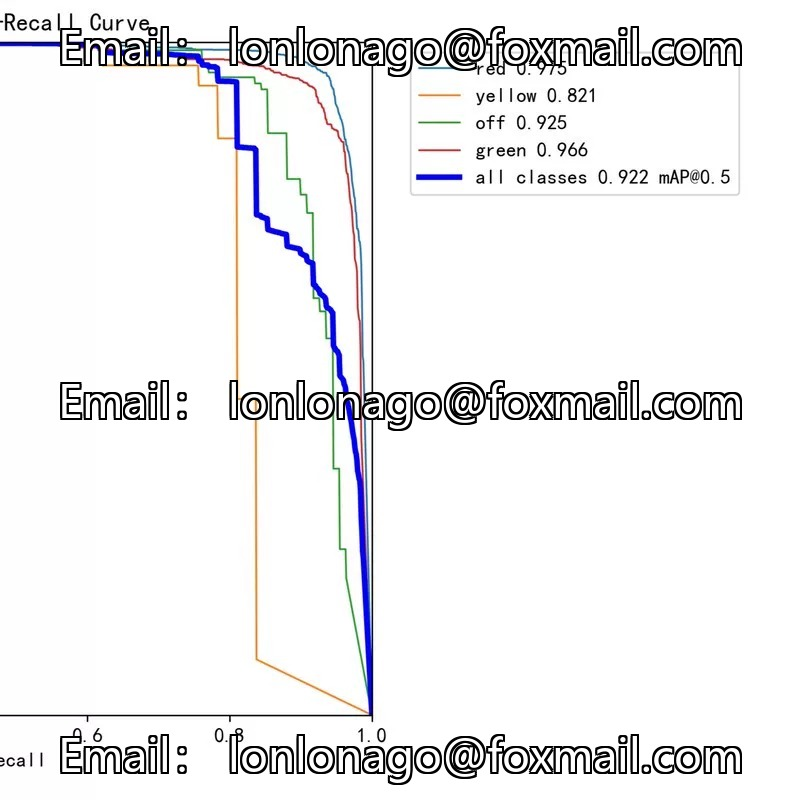
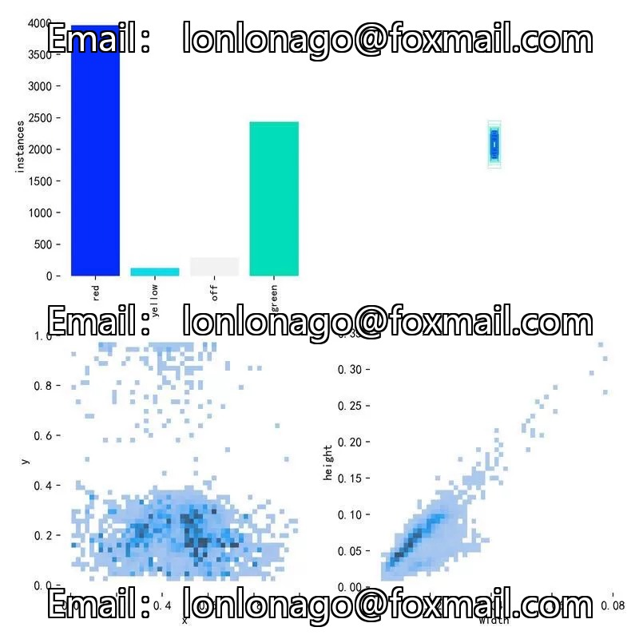

# Traffic signal light detection system based on YOLO, including 3000 images of traffic lights.

## Body

Traffic signal light detection system based on YOLO, including 3000 images of traffic lights, can be used for training and testing. The dataset contains four categories: red light (red), green light (green), yellow light (yellow), and signal off. It comes with complete training and testing code, supports models Yolov11 and Yolov8, as well as a graphical interface using Pyside and a Web interface using Gradio.

The product is an electronic device. Once sold, it is non-refundable and not intended for research or learning purposes. It is not a hacking tool; the buyer's use is unrelated to me.

Friends interested in joining are welcome to contact us.

## Images

## Payment

Here is a pay link on Stripe ( https://buy.stripe.com/3cs8yP7sY87d0vu9AB ). Please contact me lonlonago@foxmail.com after funding $89, and I will send you a complete data files , thank you!

